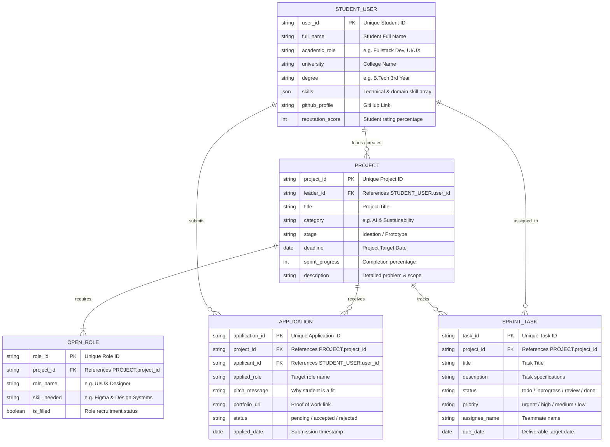

# SkillBridge: Academic Minor/Major Project Documentation

---

## 1. Project Title
**Primary Title:**  
**SkillBridge: An Intelligent Campus Collaboration Platform for Project Discovery, Complementary Skill Matchmaking, and Agile Task Tracking**

**Alternative Sub-Titles for Academic Submission:**
- *SkillBridge: Student Project Matchmaker & Team Task Tracker*
- *SkillBridge: Bridging the Student Skill Gap through Complementary Matchmaking & Kanban Sprint Boards*

---

## 2. Executive Summary / Abstract
In academic environments, students frequently conceptualize innovative ideas for minor, major, and interdisciplinary hackathon projects. However, they encounter three core hurdles:
1. **Discovery Gap:** Inability to find projects aligned with their learning goals.
2. **Skill Mismatch & Redundancy:** Forming teams with identical skill sets (e.g., four backend coders with no UI/UX designer), leading to project abandonment.
3. **Execution Gap:** Lack of structured sprint planning and milestone tracking tools tailored to student teams.

**SkillBridge** solves this with a single unified platform featuring:
- **Project Discovery & Idea Pitching:** Centralized showcase for university projects and hackathon concepts.
- **Smart Complementary Matchmaking:** Calculates a compatibility percentage based on needed team roles versus applicant skills.
- **Team Leader Hub:** Streamlined review, approval, and management of incoming teammate applications.
- **Interactive Kanban Workspace:** Real-time To Do, In Progress, Review, and Done task board for tracking milestones until submission.

---

## 3. Hardware and Software Requirements

### A. Hardware Requirements
| Component | Minimum Specification | Recommended Specification |
| :--- | :--- | :--- |
| **Processor** | Intel Core i3 (4th Gen) / AMD Ryzen 3 | Intel Core i5 / AMD Ryzen 5 or higher |
| **RAM** | 4 GB | 8 GB or 16 GB |
| **Hard Disk / SSD** | 20 GB free disk space | 50 GB SSD |
| **Display Resolution** | 1366 x 768 pixels | 1920 x 1080 (Full HD) |
| **Network Interface** | Standard Broadband / Wi-Fi | High-speed Internet Connection |

### B. Software Requirements
| Category | Tool / Software | Details |
| :--- | :--- | :--- |
| **Operating System** | Windows 10/11, macOS, or Linux (Ubuntu 20.04+) | Cross-platform compatible |
| **Client Browser** | Google Chrome 90+, Microsoft Edge, Mozilla Firefox | Supports ES6 JavaScript, HTML5, CSS3 |
| **Development Environment (IDE)** | VS Code / Antigravity IDE / Sublime Text | For editing code & extensions |
| **Local Web Server** | Python `http.server`, Node.js `serve`, or Live Server | Port 3000 / 8080 |
| **Version Control** | Git & GitHub | Code repository & version tracking |
| **Documentation & Presentation** | Microsoft Office Word & PowerPoint / Google Docs & Slides | Report & PPT creation |

---

## 4. Technologies Required & Architectural Stack

### Frontend Architecture
- **HTML5 (HyperText Markup Language 5):** Semantic page structure, modal dialogs, accessible navigation (`<header>`, `<nav>`, `<main>`, `<section>`, `<footer>`).
- **Vanilla CSS3 (Design System):** 
  - CSS Custom Variables for dynamic theming (Midnight studio palette, glowing violet/cyan accents).
  - Glassmorphism effects with backdrop blur and responsive CSS Grid / Flexbox layouts.
  - Micro-animations for transitions and hover states.
- **JavaScript (ES6+):**
  - Modular DOM manipulation and Single Page Application (SPA) view switching.
  - Asynchronous event listeners for real-time search filtering and debounced queries.
  - HTML5 Drag and Drop API for Kanban task board column movement.

### Data Storage & Client State
- **Web Storage API (`localStorage`):** Persistent client-side database preserving students, projects, application workflows, and sprint tasks across page reloads without requiring complex database configuration for minor project defense.
- **Complementary Matchmaking Algorithm:** Calculates synergy points between student skills (Frontend, AI/ML, Design, Hardware, Mobile) and unfilled project roles.

### Future Major Project Upgrade Path (Full-Stack Roadmap)
- **Backend API:** Node.js + Express.js / Python FastAPI.
- **Database:** MongoDB / PostgreSQL with Prisma ORM.
- **Authentication:** JWT (JSON Web Tokens) or OAuth2 (Sign in with Google / GitHub).
- **Real-Time Communication:** Socket.io for live team chat and instant push notifications.

---

## 5. Entity-Relationship (ER) Diagram & Schema Design

### A. Conceptual & Relational ER Schema

The database model connects students, projects, role requirements, applications, and sprint tracking tasks:

### B. Relational Cardinality Summary
1. **User to Project (1 : N):** One student can initiate and lead multiple projects.
2. **Project to Open Role (1 : N):** A project can advertise multiple unfilled technical roles.
3. **Student to Application (1 : N):** A student can apply to multiple open project positions.
4. **Project to Application (1 : N):** A project receives applications from diverse student candidates.
5. **Project to Sprint Task (1 : N):** A project workspace contains multiple sprint tasks across the Kanban lifecycle.

---

## 5. Complete Slide-by-Slide PPT Presentation Structure (12 Slides)

### Slide 1: Title Slide
- **Project Title:** SkillBridge
- **Subtitle:** An Intelligent Platform for Project Discovery, Student Skill Matching & Team Task Tracking
- **Course / Degree:** Bachelor of Technology (B.Tech / B.E / BCA / MCA)
- **Submitted By:** [Your Name(s) & Roll Numbers]
- **Under the Guidance of:** [Mentor / Professor Name]
- **Department & College:** Department of Computer Science & Engineering, [College Name]

### Slide 2: Problem Statement & Motivation
- **The Core Issue:** Students possess innovative ideas but struggle to locate suitable projects and complementary team members.
- **Pain Points:**
  - Skill Redundancy: Teams often form with duplicate strengths and crucial skill gaps.
  - Scattered Communication: Project discovery happens across unorganized WhatsApp/Discord groups.
  - Lack of Task Tracking: No centralized milestone tracker leads to missed submission deadlines.

### Slide 3: Proposed Solution
- **One Unified Academic Hub:**
  1. **Idea & Project Discovery:** Explore campus projects categorized by domain (AI, Web, Mobile, IoT, Web3).
  2. **Complementary Skill Matching:** Matchmaking algorithm highlighting compatibility percentages.
  3. **Team Leader Recruitment Hub:** Simple application review, acceptance, and role assignment.
  4. **Sprint Workspace:** Kanban board for managing tasks from ideation to final submission.

### Slide 4: System Architecture & Workflow
- Flow Diagram:
  - `Student Profile (Skills Defined)` ➔ `Explore Projects` ➔ `Complementary Fit Calculation` ➔ `One-Click Application` ➔ `Leader Approves` ➔ `Added to Team & Workspace Kanban Activated`.

### Slide 5: Key Modules of SkillBridge
- **Module 1: Home & Analytics:** Live metrics showing active projects, registered students, and open roles.
- **Module 2: Project Discovery:** Real-time search by keywords (e.g., "Python", "React", "Figma") and domain filtering.
- **Module 3: Student Skill Profiling:** Technical ratings, GitHub/LinkedIn integration, and complementary skill needs.
- **Module 4: Team Leader Portal:** Application review interface with applicant pitch, portfolio link, and one-click accept/decline.
- **Module 5: Project Workspace & Kanban:** 4-column agile board (To Do, In Progress, Review, Done) with priority badges and assignee avatars.

### Slide 6: The Complementary Skill Matchmaking Algorithm
- **How It Works:**
  - Evaluates open project requirements against user skill sets.
  - Rewards complementary pairings (e.g., Designer + Backend Dev = High Synergy).
  - Dynamically updates match score badges (e.g., "94% Match") on project discovery cards.

### Slide 7: Hardware & Software Specifications
- Hardware: Standard PC/Laptop (Intel i3/i5, 4GB+ RAM).
- Software: Chrome/Edge/Firefox, VS Code, Python/Node server, Git.
- Tech Stack: Semantic HTML5, Modern CSS3 (Glassmorphism & Midnight Palette), Modular JavaScript (ES6+), LocalStorage API.

### Slide 8: Database & Data Model Design
- Entities:
  - `User/Student:` ID, Name, Role, University, Skills, Stats.
  - `Project:` ID, Title, Category, Open Roles, Team Members, Progress.
  - `Application:` ID, Project ID, Applicant ID, Pitch Message, Status (Pending, Accepted, Rejected).
  - `Task:` ID, Project ID, Title, Status, Priority, Assignee, Due Date.

### Slide 9: Demo & UI Screenshots
- *Placeholder for Screenshots:*
  - Hero landing & statistics counters.
  - Explore projects grid with dynamic match score badges.
  - Team leader dashboard with applicant cards.
  - Kanban sprint task board in action.

### Slide 10: Testing & Results
- Verified zero external runtime dependencies.
- Verified persistent state across browser reloads using LocalStorage.
- Responsive design tested across desktop, tablet, and mobile viewports.
- Tested drag-and-drop task movement across all four Kanban columns.

### Slide 11: Scope for Future Enhancement (Major Project Conversion)
- Integration of University Single Sign-On (SSO).
- AI-driven automated resume parsing using NLP.
- WebSocket-based real-time group chat and file sharing.
- Plagiarism and duplicate project proposal detector.

### Slide 12: Conclusion & References
- **Conclusion:** SkillBridge transforms the disjointed student project lifecycle into a seamless, productive, and collaborative experience.
- **Q&A:** "Thank you! We welcome questions and feedback."

---

## 6. Academic Project Report Format (Standard Soft Copy Layout)

For your formal soft copy submission (Word / PDF document), follow this standard university format:

1. **Cover Page:** Project Title, Student Names, Roll Nos, College Logo, Department.
2. **Certificate of Approval:** Signed by Guide, HOD, and External Examiner.
3. **Declaration:** Student declaration of original work.
4. **Acknowledgement:** Thanks to mentor, department faculty, and college.
5. **Table of Contents, List of Figures, List of Tables.**
6. **Chapter 1: Introduction**
   - 1.1 Background & Motivation
   - 1.2 Problem Statement
   - 1.3 Objectives
7. **Chapter 2: Literature Survey / Existing Systems**
   - 2.1 Study of existing platforms (LinkedIn, Devpost, Trello)
   - 2.2 Identification of research & practical gaps
8. **Chapter 3: System Requirements & Feasibility**
   - 3.1 Hardware Requirements
   - 3.2 Software Requirements
   - 3.3 Technical & Operational Feasibility
9. **Chapter 4: System Design & Architecture**
   - 4.1 System Architecture Diagram
   - 4.2 Data Flow Diagram (DFD - Level 0, 1)
   - 4.3 Database Schema / Data Models
10. **Chapter 5: Implementation Details**
    - 5.1 Project Discovery & Filter Logic
    - 5.2 Complementary Matchmaking Algorithm
    - 5.3 Kanban Board State Management
11. **Chapter 6: Results & Screenshots**
12. **Chapter 7: Conclusion & Future Scope**
13. **References / Bibliography**

---

## 7. Teacher Evaluation & Viva Questions Guide (Expected Q&A)

Here are the most common questions professors and external examiners ask, along with the ideal model answers:

### Q1: "What is novel or unique about SkillBridge compared to LinkedIn or Devpost?"
> **Answer:**  
> "Existing platforms like LinkedIn are broad professional networks with high noise and no academic project context, while platforms like Trello or Jira only track tasks after a team is already formed. **SkillBridge is a single unified academic pipeline** that connects:
> 1. Initial idea pitching & open role specification,
> 2. **Complementary skill matchmaking** to prevent team skill overlap, and
> 3. Built-in Sprint Kanban task tracking until final semester submission."

### Q2: "Can you explain your database / data model relationships?"
> **Answer:**  
> "Our ER model has 5 core relational entities: `STUDENT_USER`, `PROJECT`, `OPEN_ROLE`, `APPLICATION`, and `SPRINT_TASK`.
> - A student creates and leads a project (1:N).
> - Each project requires multiple open roles (1:N).
> - Other students submit applications referencing the project and user (1:N).
> - When the team leader accepts an applicant, the student is dynamically added to the project's roster, and tasks can be assigned to them directly on the Sprint Kanban board (1:N)."

### Q3: "How does your Complementary Skill Matchmaking algorithm work?"
> **Answer:**  
> "Rather than doing simple keyword searches, our synergy engine compares the active student's technical skills against the unfilled open roles of a project. Direct matches give a full score (+2.0), while complementary skill pairings (e.g., pairing a UI/UX Designer with a Backend-heavy project, or an ML specialist with a Data Engineering role) give synergy points (+1.5). This yields a dynamic compatibility percentage (e.g., 94% Match) that helps students quickly find teams that genuinely need their unique expertise."

### Q4: "How is data persisted in this minor project, and how will it scale for your major project?"
> **Answer:**  
> "For this minor project phase, we implemented persistent client-side storage using the HTML5 Web Storage (`localStorage`) API. This allows the application to run completely standalone with zero database setup overhead while retaining all changes across reloads. For our upcoming major project phase, we will migrate this data model directly to a **Node.js/Express backend with MongoDB / PostgreSQL and Prisma ORM**, accompanied by WebSocket real-time chat."
